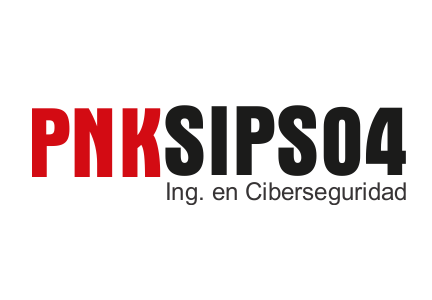
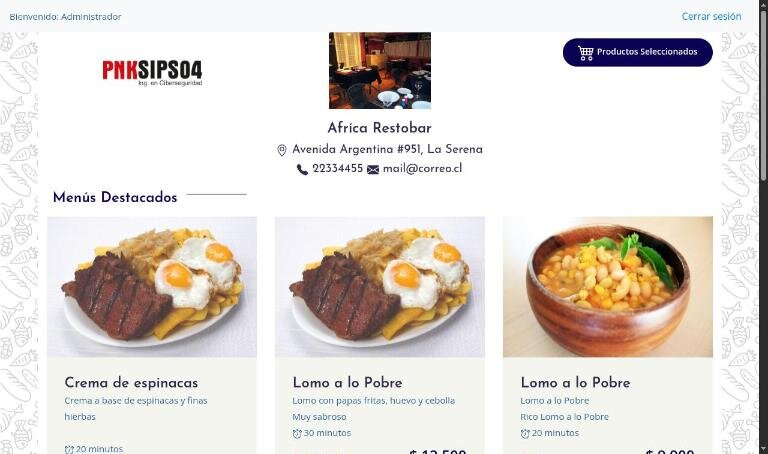
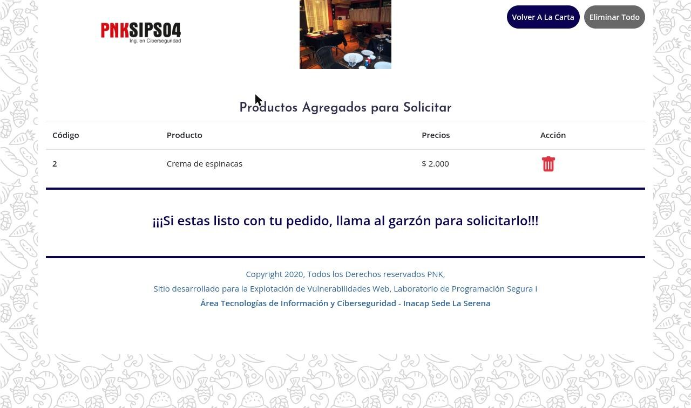
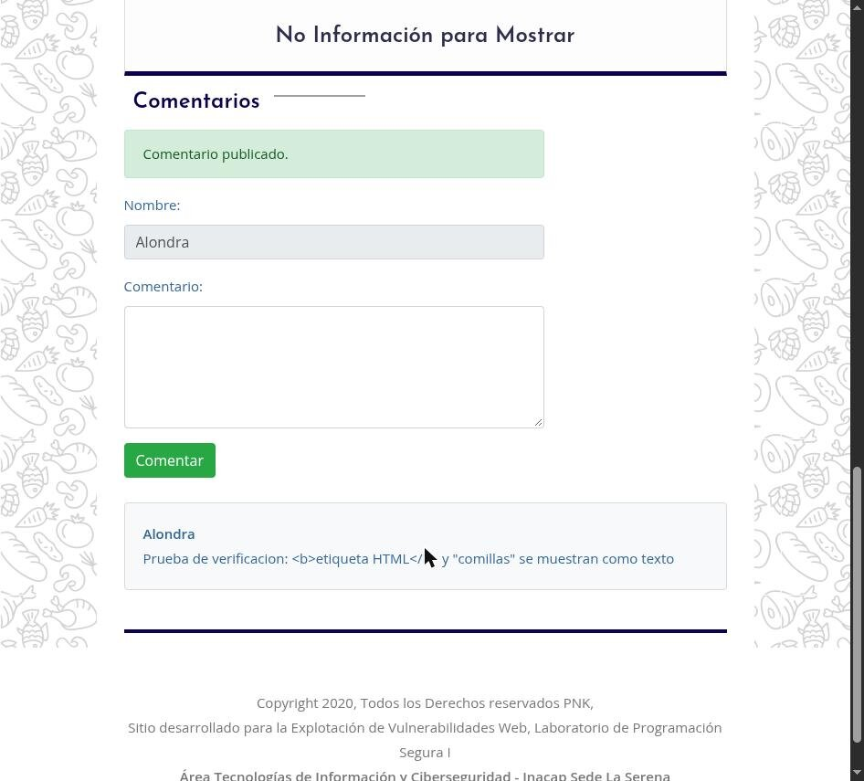
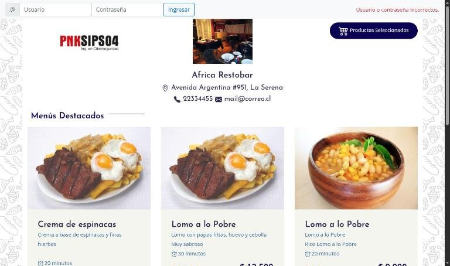

<div align="center">



# 🛡️ pnkSecurity

**Menú digital con carrito para restaurantes** — versión *corregida* de una aplicación PHP que se entregó con vulnerabilidades a propósito, trabajada en el Laboratorio de Programación Segura I (INACAP Sede La Serena).




</div>

---

## 📋 Índice

- [¿Qué hace?](#-qué-hace)
- [Las dos versiones del proyecto](#-las-dos-versiones-del-proyecto)
- [Seguridad: qué se corrigió](#-seguridad-qué-se-corrigió)
- [Seguridad de PHP: PHP2Shell](#-seguridad-de-php-php2shell)
- [Trazabilidad por vulnerabilidad](#-trazabilidad-por-vulnerabilidad)
- [Stack técnico](#-stack-técnico)
- [Estructura del proyecto](#-estructura-del-proyecto)
- [Correrlo en local](#-correrlo-en-local)
- [Variables de entorno](#-variables-de-entorno)
- [Despliegue (AWS)](#-despliegue-aws)
- [Riesgo residual](#-riesgo-residual)
- [Integrantes](#-integrantes)

## ✨ ¿Qué hace?

| | |
|---|---|
| 🍽️ **Carta por restaurante** | Cada restaurante tiene su carta (`index.php?id=1`) con menús destacados, categorías, fotos, tiempos y precios en pesos chilenos. |
| 🛒 **Carrito** | Se agregan y quitan productos con AJAX. El precio siempre se toma de la base de datos, nunca del navegador. |
| 💬 **Comentarios** | Quien inició sesión puede dejar comentarios en la carta; el autor sale de su sesión, no de un campo editable. |
| 🔐 **Login** | Ingreso con correo y contraseña, mensajes genéricos y bloqueo temporal tras varios intentos fallidos. |

<details>
<summary><b>📸 Más capturas</b></summary>

<br>

| Carrito | Comentarios |
|---|---|
|  |  |

| Login con clave incorrecta |
|---|
|  |

</details>

## 🌿 Las dos versiones del proyecto

| Rama | Qué contiene |
|---|---|
| `main` | La aplicación **original, vulnerable a propósito** (para la fase de pentesting). No usar en producción. |
| `mejoras-por-vul` | La versión **corregida**, con **un commit por vulnerabilidad** (`VUL-01` a `VUL-12`) para ver cómo se solucionó cada una, siete mejoras posteriores (M1 a M7) y la documentación en `docs/`. Los commits de VUL-01 a VUL-10 se leen como diff por vulnerabilidad, pero la aplicación se ejecuta completa desde `0fa272c` (VUL-11): ver la [trazabilidad](#-trazabilidad-por-vulnerabilidad). |

Cada corrección está documentada con evidencia antes/después en el [Informe de remediación](docs/INFORME_REMEDIACION_pnkSecurity.docx). Los 20 hallazgos originales del pentesting están en el [Informe técnico](docs/INFORME_TECNICO_pnkSecurity.docx), que además trae un anexo con el commit que corrige cada uno (los 20 hallazgos se agrupan en las 12 VUL de esta tabla). El parche de las fallas de PHP (PHP2Shell, octubre de 2026) está en el [Informe PHP2Shell](docs/INFORME_PHP2SHELL_pnkSecurity.pdf).

## 🔒 Seguridad: qué se corrigió

| N° | Vulnerabilidad | OWASP Top 10:2025 | Severidad | Corrección |
|---|---|---|---|---|
| VUL-01 | Inyección SQL en `?id=` y formularios | A05 Injection | 🔴 Crítica | Consultas preparadas (`consultar()` / `ejecutar()`) |
| VUL-02 | Inyección SQL en el login (bypass) | A05 / A07 | 🔴 Crítica | Consulta parametrizada y verificación de clave en PHP |
| VUL-03 | IDOR sobre el id de restaurante | A01 Broken Access Control | 🟠 Alta | Id validado en el servidor; autor tomado de la sesión |
| VUL-04 | XSS almacenado y reflejado | A05 Injection | 🟡 Media | Escape de salida con `e()` y rutas de imagen con lista blanca |
| VUL-05 | Sesión insegura | A07 Authentication Failures | 🟠 Alta | `HttpOnly`, `SameSite=Strict`, regenerar ID, caducidad |
| VUL-06 | Sin protección CSRF | A01 | 🟡 Media | Token por sesión validado con `hash_equals()` |
| VUL-07 | Validación insuficiente de entradas | A06 Insecure Design | 🟡 Media | `entero_get()` / `entero_post()`, límites y tipos |
| VUL-08 | Contraseñas en texto plano | A04 Cryptographic Failures | 🔴 Crítica | Comparación en tiempo constante (`verificar_password()`); ya acepta hashes. *Parcial: la base de datos no se modifica, ver riesgo residual* |
| VUL-09 | Credenciales de BD en el código | A02 Security Misconfiguration | 🟠 Alta | Variables de entorno `PNK_DB_*`, rechazo de `root` sin clave con `PNK_ENV=production` y usuario `pnk_app` de mínimo privilegio en el despliegue de AWS |
| VUL-10 | Sin límite de intentos ni registro | A07 / A09 | 🟡 Media | Bloqueo por cuenta + IP y log de eventos de seguridad |
| VUL-11 | Errores y cabeceras expuestos | A02 / A10 | 🟢 Baja | CSP sin `unsafe-inline`, `X-Frame-Options`, `nosniff`, HTTPS forzado con HSTS, errores genéricos, `.htaccess` |
| VUL-12 | jQuery 3.2.1 desactualizado | A03 Supply Chain | 🟡 Media | Actualizado a jQuery 3.7.1 y SRI (`integrity`) en los recursos de `vendors/` |

Después de la remediación se agregaron siete mejoras, cada una en su propio commit:

| Mejora | Commit | Qué hace |
|---|---|---|
| M1 | `6f80567` | HTTPS detrás de un balanceador: `X-Forwarded-Proto` solo se respeta con `PNK_TRUST_PROXY=1` (cookie `Secure` y HSTS) |
| M2 | `a47e6ba` | Hash señuelo en el login cuando la cuenta no existe (no toca la base de datos) |
| M3 | `2cb5c71` | Limpieza del repositorio (archivos duplicados y de sistema) |
| M4 | `972f8c1` | Con `PNK_ENV=production` la aplicación se niega a conectar como `root` sin contraseña |
| M5 | `072b24a` | `PNK_FORCE_HTTPS=1`: redirección a HTTPS (301) y HSTS con `includeSubDomains` |
| M6 | `0d5c58f` | CSP sin `'unsafe-inline'` y sin Google Fonts externo |
| M7 | `bc6a02b` | SRI (`integrity`) en los scripts y estilos de `vendors/` |

## 🐘 Seguridad de PHP: PHP2Shell

El 21/10/2026 el proyecto PHP publicó el parche de dos fallas críticas **del propio intérprete**: **CVE-2026-109618** y **CVE-2026-109619** (CVSS 9.2). Permiten ejecución remota de código y el caso más expuesto es Apache con `mod_php`, que es como se despliega esta aplicación. No están en el código de pnkSecurity, así que las correcciones VUL-01 a VUL-12 **no** las mitigan: la solución es actualizar PHP.

| Entorno | Antes | Ahora |
|---|---|---|
| Servidor de AWS (Ubuntu 24.04, Apache + `mod_php`) | PHP 8.3 de Ubuntu | **PHP 8.5.12** desde `ppa:ondrej/php`; PHP 8.3 eliminado |
| Laboratorio local (Windows) | PHP 8.3.35 | **PHP 8.5.12** |

- **Versiones corregidas:** 8.5.12, 8.4.27, 8.3.36 y 8.2.35. Una distribución puede traer el parche con otro número de versión (en Ubuntu se comprueba con el `changelog` del paquete). PHP 7.4 y 8.0 ya no reciben soporte de seguridad.
- **Cómo se actualizó el servidor** (Ubuntu 22.04 o 24.04):

  ```sh
  sudo add-apt-repository -y ppa:ondrej/php && sudo apt-get update
  sudo apt-get install -y php8.5 libapache2-mod-php8.5 php8.5-mysql php8.5-mbstring
  sudo a2dismod php8.1 php8.3 2>/dev/null || true; sudo a2enmod php8.5
  sudo update-alternatives --set php /usr/bin/php8.5
  sudo apache2ctl configtest && sudo systemctl restart apache2   # mod_php vive dentro de Apache
  ```

- **Detalle completo:** descripción de las dos CVE, procedimiento, verificación y capturas en el [Informe PHP2Shell](docs/INFORME_PHP2SHELL_pnkSecurity.pdf) (las capturas están en [`docs/evidencias-php/`](docs/evidencias-php/)).

## 🔎 Trazabilidad por vulnerabilidad

Cada vulnerabilidad tiene su commit, con una etiqueta (`vul-01` a `vul-12`; las mejoras son `m1` a `m7` y la versión final es `entrega-final`).

| VUL | Commit | Archivos del commit | ¿Se ejecuta solo? |
|---|---|---|---|
| VUL-01 | `97bedc5` | `index.php`, `mostrar_carrito.php`, `setup/setup.php` | ❌ |
| VUL-02 | `c22e3d3` | `setup/procesalogin.php` | ❌ |
| VUL-03 | `1093e9c` | `grcomentarios.php`, `index.php`, `js/controladorajax.js` | ❌ |
| VUL-04 | `440d46a` | `index.php`, `mostrar_carrito.php`, `setup/setup.php` | ❌ |
| VUL-05 | `7699fac` | `index.php`, `mostrar_carrito.php`, `setup/cerrar_sesion.php`, `setup/setup.php` | ❌ |
| VUL-06 | `8e973f8` | `carrito.php`, `index.php`, `js/controladorajax.js`, `mostrar_carrito.php`, `setup/setup.php` | ❌ |
| VUL-07 | `10e8cec` | `js/controladorajax.js`, `mostrar_carrito.php`, `setup/setup.php` | ❌ |
| VUL-08 | `9acc8f0` | `setup/setup.php` | ❌ |
| VUL-09 | `acad159` | `setup/setup.php` | ❌ |
| VUL-10 | `db9d9d8` | `setup/setup.php` | ❌ |
| VUL-11 | `0fa272c` | `.htaccess`, `setup/setup.php` | ✅ |
| VUL-12 | `0393dff` | `index.php`, `js/main.js`, `mostrar_carrito.php` y 6 archivos de `vendors/` | ✅ |

> **Cómo usar este historial:** los commits de VUL-01 a VUL-10 separan la corrección por tema y se leen bien como diff, pero usan funciones auxiliares que se definen en commits posteriores (por ejemplo, `entero_get` y `responder_error` en `10e8cec`), así que la aplicación falla si haces checkout de uno solo. Se comprobó levantando cada commit con PHP 8.3 y MariaDB. Para ejecutar la aplicación usa `0fa272c` o uno posterior; lo recomendado es la punta de la rama. El detalle de dependencias está en el *Informe de remediación* (sección «Mapa de commits y dependencias»).

## 🧱 Stack técnico

| Parte | Herramienta | Por qué |
| :--- | :--- | :--- |
| Backend | PHP 8.5.12 (`mysqli`, `mbstring`) | Lenguaje de la aplicación original. Desplegado con PHP 8.5.12 (versión con el parche de PHP2Shell); compatible con PHP 7.4+ y probada en 7.4, 8.1, 8.3 y 8.5 |
| Base de datos | MariaDB / MySQL | Esquema en `Script_BD/pnk_security.sql` |
| Frontend | Bootstrap 4 + jQuery 3.7.1 | Interfaz y llamadas AJAX del carrito |
| Servidor | Apache (`.htaccess`) o el servidor embebido de PHP | Apache aplica el endurecimiento del `.htaccess` |

## 📁 Estructura del proyecto

```
pnkSecurity/
├─ index.php               → carta del restaurante, login y comentarios
├─ mostrar_carrito.php      → vista del carrito
├─ carrito.php               → agregar / quitar / vaciar (AJAX, POST + CSRF)
├─ grcomentarios.php          → publicar comentarios
├─ setup/
│  ├─ setup.php               → núcleo de seguridad (BD, escape, sesión, CSRF, cabeceras, log)
│  ├─ procesalogin.php         → autenticación
│  └─ cerrar_sesion.php         → cierre de sesión
├─ js/controladorajax.js       → llamadas AJAX con token CSRF
├─ .htaccess                    → endurecimiento de Apache
└─ vendors/, css/, img/, imagenes/
Script_BD/
└─ pnk_security.sql             → esquema y datos de ejemplo (la base de datos no se modifica)
docs/                               → informes (remediación, técnico y PHP2Shell) y capturas de este README
docs/evidencias-php/                → capturas del cambio de PHP (local y servidor AWS)
```

## 💻 Correrlo en local

Requisitos: PHP con las extensiones `mysqli` y `mbstring`, y MariaDB o MySQL. Recomendado: **PHP 8.5.12** (o 8.4.27, 8.3.36 u 8.2.35), que incluyen el parche de [PHP2Shell](#-seguridad-de-php-php2shell). La aplicación se probó en PHP 7.4, 8.1, 8.3 y 8.5, pero PHP 7.4 y 8.0 ya no reciben actualizaciones de seguridad: no los uses en un despliegue real.

```sh
git clone https://github.com/matiasNon/pnkSecurity.git
cd pnkSecurity
git checkout mejoras-por-vul

# 1. Crear la base de datos
mysql -u root -e "CREATE DATABASE IF NOT EXISTS pnk_security"
mysql -u root pnk_security < Script_BD/pnk_security.sql

# 2. Levantar el servidor
php -S 127.0.0.1:8000 -t pnkSecurity
# abrir http://127.0.0.1:8000/index.php?id=1
```

> El servidor embebido de PHP **no lee `.htaccess`**: sirve para probar la aplicación, pero el bloqueo de `setup.php` y de los `.sql` solo se aplica con Apache.

> **PHP 8.4 o superior:** las opciones `session.sid_length` y `session.sid_bits_per_character` del `php.ini` están obsoletas. Si las dejaste activas (vienen activas en el `php.ini-development` de PHP 8.3 y anteriores), PHP muestra avisos *Deprecated* al arrancar; coméntalas con `;`. Son los valores por defecto, así que el comportamiento no cambia.

## ⚙️ Variables de entorno

| Variable | Para qué | Por defecto |
|---|---|---|
| `PNK_DB_HOST` | Servidor de la base de datos | `localhost` |
| `PNK_DB_NAME` | Nombre de la base de datos | `pnk_security` |
| `PNK_DB_USER` | Usuario de la base de datos | `root` |
| `PNK_DB_PASS` | Contraseña de la base de datos | *(vacía)* |
| `PNK_DB_PORT` | Puerto de la base de datos | `3306` |
| `PNK_ENV` | `production` rechaza la conexión a la BD como `root` sin contraseña | *(vacío: modo laboratorio)* |
| `PNK_FORCE_HTTPS` | `1` redirige (301) a HTTPS toda petición GET/HEAD que llegue por HTTP y rechaza (403) los demás métodos | *(desactivado)* |
| `PNK_HOST` | Nombre de host público (ej. `pnk.example.cl`) al que redirige `PNK_FORCE_HTTPS`; nunca se usa la cabecera `Host` del cliente | *(vacío)* |
| `PNK_TRUST_PROXY` | `1` si hay un balanceador que termina HTTPS y envía `X-Forwarded-Proto` | *(desactivado)* |

## ☁️ Despliegue (AWS)

- Detrás de un balanceador (ALB / CloudFront) el HTTPS termina en el balanceador y PHP ve HTTP. Define `PNK_TRUST_PROXY=1` **solo** si el servidor no es accesible directamente: con la variable activa la cookie de sesión lleva `Secure` y se envía HSTS (con `includeSubDomains`).
- Para obligar a usar HTTPS define además `PNK_FORCE_HTTPS=1` y `PNK_HOST=<tu dominio>`; si falta `PNK_HOST` no se redirige y se registra el error.
- Usa Apache con `AllowOverride All` para que el `.htaccess` surta efecto.
- Define las variables `PNK_DB_*` en el servidor, con un usuario de base de datos de mínimo privilegio.
- **Instancia de evaluación:** una sola instancia EC2 con Ubuntu 24.04, Apache (`mod_php`) y MariaDB, con la rama `mejoras-por-vul` y HTTPS con certificado autofirmado (el navegador muestra una advertencia que hay que aceptar). Desde el 26/10/2026 ejecuta **PHP 8.5.12**, con el parche de PHP2Shell, y PHP 8.3 fue eliminado. El procedimiento y la verificación están en el [Informe PHP2Shell](docs/INFORME_PHP2SHELL_pnkSecurity.pdf).
- **Mantener PHP al día:** `mod_php` carga PHP dentro de Apache, así que tras actualizar PHP hay que reiniciar Apache (`sudo systemctl restart apache2`). El repositorio `ppa:ondrej/php` se está fusionando con `packages.sury.org/php`; sigue siendo utilizable para Ubuntu 22.04 y 24.04, pero conviene vigilar la migración para seguir recibiendo parches.

## ⚠️ Riesgo residual

- **Contraseñas en texto plano:** la base de datos no se modifica, así que las claves de `usuarios` siguen guardadas sin hash. El código ya usa `password_verify()` si encuentra un hash, por lo que migrarlas a futuro no requiere cambios en la aplicación.
- **Usuario de BD:** por defecto la conexión usa `root` sin contraseña (para no romper el entorno de laboratorio). Con `PNK_ENV=production` la aplicación se niega a conectarse así y registra el intento; en producción hay que crear un usuario con privilegios mínimos y definir `PNK_DB_*`.
- **Versión de PHP:** la seguridad de la aplicación depende también del intérprete (PHP2Shell lo demostró). Hay que seguir los avisos de seguridad de PHP y de los paquetes del sistema operativo, y comprobar el parche en el `changelog` del paquete cuando la distribución use otro número de versión.
- **Contadores de intentos de login:** se guardan en un archivo temporal local; con varias instancias detrás de un balanceador cada una lleva su propia cuenta.
- **CSP:** la política ya no permite `'unsafe-inline'` ni dominios externos (los estilos en línea pasaron a clases de `css/style.css` y se quitó Google Fonts: los textos usan las fuentes del sistema como respaldo).
- **SRI:** las librerías de `vendors/` que cargan `index.php` y `mostrar_carrito.php` llevan `integrity="sha384-..."`. Si actualizas una de ellas, recalcula el hash: `openssl dgst -sha384 -binary <archivo> | openssl base64 -A`. El `.gitattributes` evita que Git convierta los saltos de línea de `vendors/` (en Windows con `autocrlf` el hash dejaría de coincidir).

## 👥 Integrantes

- Matías Nonque
- Savka Carvajal

<sub>Proyecto académico — Área Tecnologías de Información y Ciberseguridad, INACAP Sede La Serena. La rama `main` contiene vulnerabilidades intencionales.</sub>
